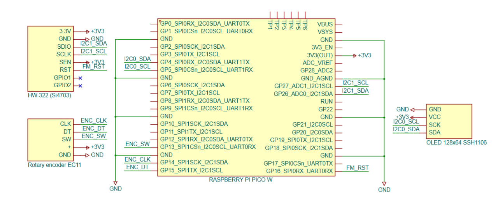

Hardware
========

Components
----------

* Raspberry Pi Pico W (RP2040, 3,3 V logic) on a DFRobot Pico Gravity Board
* Si4703 FM receiver breakout board (I2C, 3,3 V)
* 1,3" SH1106 OLED display, 128x64 pixels (I2C, 3,3 V)
* EC11 rotary encoder with pushbutton (``SW``)
* Headphones in the 3,5 mm jack of the Si4703 module (audio output and
  FM antenna)

Schematic
---------

Pinout and I2C buses
--------------------

The Si4703 and the SH1106 use separate I2C buses. The 2-wire reset of the
Si4703 temporarily drives SDA as a digital output, which would disturb the
display on a shared bus.

.. list-table::
   :header-rows: 1
   :widths: 20 15 15 15 35

   * - Component
     - Module pin
     - Pico W GPIO
     - Bus
     - Notes
   * - SH1106 OLED
     - SDA
     - GP4
     - I2C0
     - 400 kHz, address 0x3C
   * - SH1106 OLED
     - SCL
     - GP5
     - I2C0
     - 400 kHz
   * - Si4703 tuner
     - SDIO
     - GP26
     - I2C1
     - 400 kHz, address 0x10
   * - Si4703 tuner
     - SCLK
     - GP27
     - I2C1
     - 400 kHz
   * - Si4703 tuner
     - RST
     - GP16
     - digital out
     - held low in ``boot.py`` (no start-up click)
   * - EC11 encoder
     - CLK
     - GP14
     - digital in, IRQ
     - internal pull-up
   * - EC11 encoder
     - DT
     - GP15
     - digital in, IRQ
     - internal pull-up
   * - EC11 encoder
     - SW
     - GP13
     - digital in
     - active low, internal pull-up

Assumptions and limitations
---------------------------

* All peripherals run at 3,3 V from the Pico W / Gravity Board.
* Speakers are never driven from Pico GPIO pins; audio comes from the
  jack of the Si4703 module.
* The Si4703 has one RF front-end, so playback pauses during the
  auto-scan.
* RDS reception depends on the headphone cable (antenna) and the local
  signal strength.
