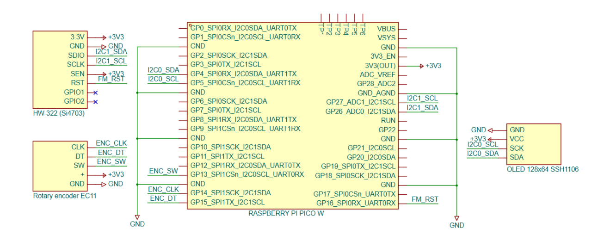

# Pico W FM Radio Receiver


Digital FM radio receiver (88.0–108.0 MHz) built on a Raspberry Pi Pico W in MicroPython for the DE2 course at VUT FEKT (2026). Combines an Si4703 FM tuner, a 128x64 SH1106 OLED display, and an EC11 rotary encoder with pushbutton for manual tuning, hardware seek, interactive band auto-scan, volume control, and live RDS decoding (station name and scrolling RadioText).

- **Online API Documentation (Sphinx):** [GitHub Pages](https://daniil-yeriemieiev.github.io/pico-fm-receiver/) *(or [build locally](#building-sphinx-documentation-locally) from [`docs/sphinx/`](docs/sphinx/))*
- **Project Poster (A3):** Coming soon
- **Demonstration Video (1–2 min):** Coming soon

---

## Team Members

- **Daniil Yeriemieiev** — System architecture, rotary encoder integration, modular application logic ([`src/boot.py`](src/boot.py), [`src/main.py`](src/main.py), [`src/multi_button.py`](src/multi_button.py), [`src/radio_ui.py`](src/radio_ui.py), [`src/station_store.py`](src/station_store.py)), integration testing, and repository documentation.
- **Maxim Sudakov** — Custom Si4703 driver ([`lib/fm_tuner.py`](lib/fm_tuner.py)), I2C debugging, RDS PS/RadioText decoding, and Sphinx documentation setup ([`docs/sphinx/`](docs/sphinx/)).
- **Gleb Dulesov** — Hardware assembly on the DFRobot Pico Gravity Board, OLED UI design and verification, component testing, and presentation materials.

---

## Controls and Operating Modes

### Normal Mode
- **Rotate:** Adjusts the active parameter (frequency in 100 kHz steps across 88.0–108.0 MHz with wrap-around, or volume 0–15). Rapid rotation defers blocking tuner writes by 120 ms so no encoder steps are dropped.
- **Single Click (`SW`):** Toggles encoder control between **Frequency** and **Volume** (active value is underlined on the OLED).
- **Press & Hold (`SW`):** Triggers a non-blocking hardware seek upward to the next strong station.
- **Double Click (`SW`):** Opens the **Auto-Scan Menu**.

### Auto-Scan Menu
- **Single Click (`SW`):** Starts or stops a full-band auto-scan (88.0–108.0 MHz). Discovered stations are saved to a temporary session file (`autoscan_tmp.csv`, automatically deleted on exit).
- **Rotate:** Scrolls through the discovered station table on the OLED.
- **Press & Hold (`SW`):** Tunes to the highlighted station and returns to Normal Mode.
- **Double Click (`SW`):** Exits back to Normal Mode without changing station (aborts scan if running).

All runtime events (`[INIT]`, `[MODE]`, `[TUNE]`, `[VOL]`, `[SEEK]`, `[SCAN]`, `[RDS]`, `[STORE]`) are logged with timestamps to the USB serial terminal.

---

## OLED Display Layout (128x64)

Rendered by [`RadioUI`](src/radio_ui.py) (8x8 px font).

### Normal Mode (3x3 Logical Grid)

```text
 x:  0          44                          127
y=0  +---------+-------------------------------+
     | 1.1     | 1.2 - 1.3                     |  Row 1 (y 0-19)
     | [|||]34 | IMPULS   (RDS PS / SEEKING..) |
y=20 +---------+-------------------------------+
     | 2.1     | 2.2 - 2.3                     |  Row 2 (y 21-41)
     |  88.3   | Now playing... (RT marquee)   |
     |  -----  |                               |
y=42 +---------+-------------------------------+
     | 3.1     | 3.2 - 3.3                     |  Row 3 (y 43-63)
     |  <)))   | [########----]  10            |
y=63 +---------+-------------------------------+
```

| Zone | Element | Position (px) | Behavior |
| :--- | :--- | :--- | :--- |
| **1.1** | RSSI | Icon `(2, 4)`, value `(18, 6)` | Dynamic 0–4 bar icon scaling with RSSI + numeric value. |
| **1.2 – 1.3** | Station Name | `(44, 6)` | RDS PS (up to 8 chars), `SEEKING..`, or `NO RDS`. |
| **2.1** | Frequency | `(0, 28)` | Active/pending frequency in MHz; underlined (`y=37`) in Frequency mode. |
| **2.2 – 2.3** | RadioText | `(44, 28)`, 10 chars | Scrolling RDS RT marquee (250 ms step) once fully received. |
| **3.1** | Speaker | `(2, 48)` | Dynamic icon: crossed out at `0`, 1–3 sound waves for low/mid/high volume. |
| **3.2 – 3.3** | Volume | Bar `(44, 50)` (56x8), value `(106, 50)` | Progress bar + level (`0`–`15`); value underlined (`y=59`) in Volume mode. |

### Auto-Scan Menu (Full-Screen Scrollable Table)

```text
 x:  0    19        63                      127
y=0  +-----------------------------------------+
     | RS  FREQ     RDS                   2/12 |  Header (or "SCAN  95.1 [4]")
y=10 +-----------------------------------------+
     | 34  87.6     IMPULS                     |
     |[41  88.3     KISS    ]                  |  Inverted highlight bar
     | 28  95.1     R-ZURNAL                   |  (up to 5 visible rows)
     | 22  99.4     ---                        |
     | 37 105.5     EVROPA 2                   |
y=63 +-----------------------------------------+
```

---

## Hardware and Wiring

- **Board:** Raspberry Pi Pico W (RP2040, 3.3 V) on a DFRobot Pico Gravity Board
- **Peripherals:** Si4703 FM tuner (`I2C1`), 1.3" SH1106 OLED (`I2C0`), EC11 rotary encoder with `SW` button, 3.5 mm headphones (audio output and FM antenna)



| Component | Pin | Pico GPIO | Bus / Mode | Notes |
| :--- | :--- | :--- | :--- | :--- |
| **SH1106 OLED** | SDA / SCL | `GP4` / `GP5` | `I2C0` (400 kHz) | Address `0x3C` |
| **Si4703 Tuner** | SDIO / SCLK | `GP26` / `GP27` | `I2C1` (400 kHz) | Address `0x10`, separate bus to isolate 2-wire reset |
| **Si4703 Tuner** | RST | `GP16` | Digital Out | Held low in [`src/boot.py`](src/boot.py) to prevent power-up click |
| **EC11 Encoder** | CLK / DT | `GP14` / `GP15` | Digital In (IRQ) | Internal pull-up, `reverse=True` |
| **EC11 Encoder** | SW | `GP13` | Digital In | Active-low, internal pull-up |

**Limitations:** 3.3 V logic only; headphones/powered amp must connect to the Si4703 jack (never to Pico GPIOs); single RF front-end pauses playback during Auto-Scan; RDS depends on headphone cable orientation and signal strength.

---

## Architecture and Timing Plan

The application uses a **Multi-Rate Non-Blocking Superloop with Hardware Interrupts** (no `uasyncio`). Fast input polling is decoupled from slower I2C bus operations via `time.ticks_ms()`:

| Activity | Mechanism | Interval / Timing | Responsibility |
| :--- | :--- | :--- | :--- |
| **Encoder Rotation** | Hardware IRQ | Immediate (< 50 us) | Updates quadrature state machine and sets `encoder_rotated` flag. |
| **Button Gestures** | Superloop poll | Every `5 ms` | Debounce `15 ms`, double-click window `400 ms`, hold `600 ms`. |
| **Deferred Tuning** | Settle timer | `120 ms` after last step | Avoids blocking `radio.tune()` calls during rapid rotation. |
| **Tuner, Seek & RDS** | Superloop poll | Every `30 ms` | Runs `radio.poll()` / `radio.seek_update()`; auto-scan waits up to `4700 ms` for RDS PS. |
| **OLED Refresh** | Throttled render | `100 ms` (`50 ms` min on change) | Redraws SH1106 framebuffer without starving button/encoder polling. |

---

## Project Structure and Modules

| Path | Class / Scope | Description |
| :--- | :--- | :--- |
| [`src/boot.py`](src/boot.py) | `setup_environment()` | Pulls `GP16` low at boot to silence audio pops and enables GC. |
| [`src/main.py`](src/main.py) | `main()` | Hardware constants, terminal logging, and multi-rate superloop. |
| [`src/multi_button.py`](src/multi_button.py) | `MultiFunctionButton` | Extends `Button` with single-click, double-click, and hold detection. |
| [`src/radio_ui.py`](src/radio_ui.py) | `RadioUI` | 9-zone normal display renderer and full-screen Auto-Scan menu. |
| [`src/station_store.py`](src/station_store.py) | `StationStore` | Session-only CSV cache (`autoscan_tmp.csv`), auto-deleted on exit. |
| [`lib/fm_tuner.py`](lib/fm_tuner.py) | `FmTuner` | Custom Si4703 driver: tune, non-blocking seek, RSSI/stereo, RDS PS & RT. |
| [`lib/rotary.py`](lib/rotary.py), [`lib/rotary_irq_rp2.py`](lib/rotary_irq_rp2.py) | `Rotary`, `RotaryIRQ` | Quadrature state machine and RP2040 IRQ driver (MIT). |
| [`lib/gpio_devices.py`](lib/gpio_devices.py) | `Button` | Active-low button abstraction from VUT FEKT labs (MIT). |
| [`lib/sh1106.py`](lib/sh1106.py) | `SH1106_I2C` | I2C OLED framebuffer driver from VUT FEKT labs (MIT). |
| [`tests/`](tests/) | Hardware tests | [`test_fm.py`](tests/test_fm.py), [`test_encoder.py`](tests/test_encoder.py), [`test_enc_with_fm.py`](tests/test_enc_with_fm.py), [`test_enc_tune.py`](tests/test_enc_tune.py), [`test_rds_diag.py`](tests/test_rds_diag.py). |
| [`docs/sphinx/`](docs/sphinx/) | Sphinx docs | Configuration ([`conf.py`](docs/sphinx/conf.py)) and `.rst` sources for HTML API docs. |

---

## Setup and Documentation Build

### Running on Pico W
1. Flash MicroPython firmware onto the Raspberry Pi Pico W.
2. Using VS Code with **MicroPico** (or Thonny), upload the drivers from [`lib/`](lib/) and application files from [`src/`](src/) to the board root.
3. Reset the board or run [`src/main.py`](src/main.py). Hardware tests in [`tests/`](tests/) are executed directly from the PC via "Run current file".

### Building Sphinx Documentation Locally
Install Sphinx and the Read the Docs theme, then run the build from [`docs/sphinx/`](docs/sphinx/):

```bash
pip install sphinx sphinx-rtd-theme
cd docs/sphinx
make html        # Linux / macOS (or .\make.bat html on Windows)
```

Open `docs/sphinx/_build/html/index.html` in a browser.

---

## References and Third-Party Licenses

### Hardware Datasheets
- **Raspberry Pi Pico W:** [Pico W Datasheet (PDF)](https://datasheets.raspberrypi.com/picow/pico-w-datasheet.pdf) | [RP2040 Datasheet (PDF)](https://datasheets.raspberrypi.com/rp2040/rp2040-datasheet.pdf)
- **Si4703 / HW-322:** [Si4702/03-C19 Datasheet (PDF)](https://download.mikroe.com/documents/datasheets/Si4703_datasheet.pdf) | [AN230 Programming Guide (PDF)](https://cdn.sparkfun.com/datasheets/BreakoutBoards/Si4703_ProgrammingGuide.pdf)
- **EC11 Encoder & SH1106 OLED:** [ALPS EC11 Datasheet (PDF)](https://www.tme.com/Document/947fff760d3e8051ff1d91b3169c392a/ALPS-EC11.pdf) | [SH1106 Datasheet (PDF)](https://www.elecrow.com/download/SH1106%20datasheet.pdf)

### Software Attribution & Course Materials
- **Si4703 Driver ([`lib/fm_tuner.py`](lib/fm_tuner.py)):** Written by Maxim Sudakov following Silicon Labs AN230; 2-wire reset and architecture inspired by SparkFun Si4703 (MIT) and Thomas Shaddack's [si4703-RDS](https://github.com/tshaddack/si4703-RDS) (MIT).
- **Rotary Encoder ([`lib/rotary.py`](lib/rotary.py), [`lib/rotary_irq_rp2.py`](lib/rotary_irq_rp2.py)):** Mike Teachman & Eric Moyer, [micropython-rotary](https://github.com/miketeachman/micropython-rotary) (MIT). Modified: added reST docstrings, updated `reset()` to reset to `min_val`.
- **OLED & GPIO Drivers ([`lib/sh1106.py`](lib/sh1106.py), [`lib/gpio_devices.py`](lib/gpio_devices.py)):** Tomas Fryza, Shujen Chen et al., [VUT FEKT micropython-course-labs](https://gitlab.fekt.vut.cz/fryza/micropython-course-labs) (MIT).
- **Sphinx Guide:** [`HOWTO_Sphinx.md`](https://gitlab.fekt.vut.cz/fryza/micropython-course-labs/-/blob/main/docs/HOWTO_Sphinx.md).